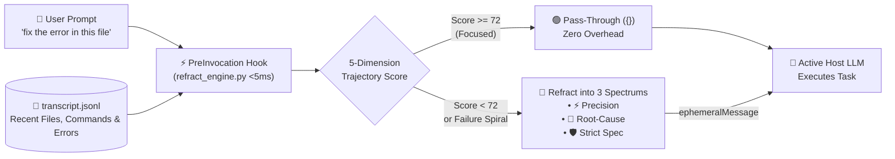

<div align="center">
  
  <h1>💎 Refract</h1>
  <p><strong>AI Context & Prompt Trajectory Engine for Google Antigravity & Modern AI Coding Assistants</strong></p>
  <p>
    <em>Stop "prompt fluffing." Start Context & Trajectory Engineering.</em>
  </p>
</div>

---

## ⚡ What Is Refract?

Most prompt extensions treat prompt refinement like copywriting—taking a 6-word developer thought (*"fix the auth bug"*) and inflating it into a 200-word generic essay (*"Act as a 10x Senior Engineer..."*) without knowing your conversation history or codebase.

**Refract** is different. Like an optical prism that takes a diffuse beam of light and refracts it into focused spectrums, Refract inspects your **live conversation trajectory (`transcript.jsonl`)** and **workspace state** in **$<5\text{ms}$** to solve the real reasons coding prompts fail:

- 🔗 **Deictic & Pronoun Context Binding**: Resolves shorthand follow-ups (*"do the same for the other handler"*, *"fix that error in this file"*) to the exact files, symbols, and tool outputs from earlier turns.
- 🛟 **Vibe-Coding Failure Spiral Rescue**: Detects when recent turns have consecutive tool/test errors or frustration prompts (*"still broken"*, *"same error"*) and automatically pivots the agent into **Root-Cause Isolation** instead of blind guessing.
- 🔀 **Pre-Flight Architectural Fork Detection**: Distinguishes between missing file context (auto-filled silently) and genuine architectural forks (e.g., caching strategy, auth flow, database choice) that need a 1-click decision before 10 files are edited.
- 🛡️ **Zero Latency & Zero Extra Token Cost**: Runs a deterministic `<5ms` pre-invocation engine locally—no secondary API key required, and strong prompts ($\ge 72/100$) pass through invisibly with zero overhead.

---

## 🧠 How It Works

### In 4 Short Bullets
1. **Intercepts (`<5ms`)**: When you send a chat message, Antigravity's `PreInvocation` hook triggers `scripts/refract_engine.py` *before* the LLM is called.
2. **Reads Trajectory**: It scans the tail of your active session (`transcript.jsonl`) to find recently edited files, test commands run, and any unresolved errors.
3. **Scores & Grounds (5-Dimension Rubric)**:
   - **Score $\ge 72$ (Clear)**: Passes through untouched (`{}`) with zero overhead.
   - **Score $< 72$ (Diffuse / Spiral / Fork)**: Binds missing file/error references and synthesizes 3 execution spectrums (**⚡ Precision**, **🔬 Root-Cause**, **🛡️ Strict Spec**).
4. **Executes with Host LLM**: Injects a transient `ephemeralMessage` (which auto-clears after the turn so it never bloats future context) and executes using your active Antigravity model (Gemini Flash / Pro / Argon).

### Architecture Diagram



---

## 📋 Quick Cheatsheet

### 1. Slash Commands (Summon Anytime)

| Slash Command | What It Does | Example |
| :--- | :--- | :--- |
| **`/refract [draft]`** | Scores your prompt against conversation history and pops up a **1-click selector** to immediately run **⚡ Precision**, **🔬 Root-Cause**, or **🛡️ Strict Spec**. | `/refract make this handler async and fix the bug` |
| **`/refract-check [draft]`** | Renders an **Interactive Generative UI Scorecard** inline in chat with 5-dimension progress bars, gap diagnostics, and clickable spectrum tabs. | `/refract-check add caching to the user endpoint` |
| **`/refract-mode`** | View or switch Refract's operating mode (`auto-intercept`, `coach`, or `slash-only`). | `/refract-mode` |

---

### 2. The 3 Refracted Spectrums

| Spectrum | Icon | When to Use It | What It Does |
| :--- | :---: | :--- | :--- |
| **Precision** | ⚡ | Everyday coding & follow-ups | Binds your prompt to exact recent file paths, prior turn intent, and active errors while preserving public interfaces. |
| **Root-Cause** | 🔬 | Debugging & "still broken" loops | Forces the agent to state its top 2 root-cause hypotheses and inspect logs/code **before** making another blind edit. |
| **Strict Spec** | 🛡️ | Production changes & refactors | Enforces minimal diff scope, explicit edge-case handling, and verification via your project's test command. |

---

### 3. Operating Modes

| Mode | How It Behaves | Best For |
| :--- | :--- | :--- |
| **`auto-intercept`** *(Default)* | Silently grounds diffuse prompts in-flight, renders a compact `<details><summary>💎 Refracted Prompt...</summary></details>` header at the top of the reply, and executes immediately. | Zero-friction daily coding. |
| **`coach`** | Pauses when a prompt scores below threshold (or hits an architectural fork) and lets you pick which spectrum to run with 1 click. | Deliberate architecture & learning prompt engineering. |
| **`slash-only`** | Disables automatic turn interception; Refract only runs when you explicitly type `/refract` or `/refract-check`. | On-demand diagnostic use only. |

---

## 💻 System Requirements & Prerequisites

Refract is designed with **zero bloat** and **zero external packages**:

| Component | Platform | What Needs to Be Installed | External Dependencies / Packages |
| :--- | :--- | :--- | :--- |
| **Refract Engine & Plugin** | **Google Antigravity** *(Phase 1 — Current)* | **Python 3.8+** (standard library only) + **Git** | **Zero `pip` packages!** Uses only built-in standard library (`sys`, `os`, `json`, `re`, `pathlib`). |
| **Refract Extension** | **VS Code** *(Phase 2 — Roadmap)* | **Node.js 18+** & **npm** | Standard VS Code Extension host & `@vscode/prompt-tsx` |

> 💡 **Notice**: For the current Google Antigravity plugin, **you do NOT need Node.js or any npm packages**. As long as your Mac or Linux system has Python 3 installed (standard on macOS), Refract works out of the box in $<5\text{ms}$.

---

## 🚀 Installation & Setup (Google Antigravity)

### Option A: Global Installation (Recommended — Works in All Workspaces)
```bash
git clone https://github.com/damiththa/Refract.git
cd Refract
./install.sh
```
> **Important**: After installing for the first time, **restart Antigravity once** so the Language Server discovers `~/.gemini/config/plugins/refract` and registers `/refract`, `/refract-check`, and `/refract-mode`.

### Option B: Workspace / Team Installation (Committed to Git)
Share Refract with your entire team inside any repository:
```bash
./install.sh --workspace /path/to/your/repo
```
This installs the plugin into `/path/to/your/repo/.agents/plugins/refract/`, which Antigravity automatically discovers for everyone working in that repository.

---

## ⚙️ Configuration & Custom Team Rules

### Global Configuration (`~/.gemini/config/plugins/refract/config.json`)
```json
{
  "mode": "auto-intercept",
  "scoreThreshold": 72,
  "rescueFailureSpirals": true,
  "maxTranscriptTurns": 12,
  "alwaysIncludeRules": []
}
```

### Project-Specific Overrides (`<your-repo>/.agents/refract.json`)
You can drop a `.agents/refract.json` file into any project repository to enforce project-specific rules in every refracted prompt:
```json
{
  "scoreThreshold": 75,
  "alwaysIncludeRules": [
    "Use strict TypeScript types (no any)",
    "Run npm test before concluding"
  ]
}
```

### CLI Utility Commands
```bash
# Check current mode and configuration
python3 ~/.gemini/config/plugins/refract/scripts/refract_engine.py --status

# Switch operating mode via terminal
python3 ~/.gemini/config/plugins/refract/scripts/refract_engine.py --set-mode coach
python3 ~/.gemini/config/plugins/refract/scripts/refract_engine.py --set-mode auto-intercept
python3 ~/.gemini/config/plugins/refract/scripts/refract_engine.py --set-mode slash-only

# Adjust the interception score threshold (0-100)
python3 ~/.gemini/config/plugins/refract/scripts/refract_engine.py --set-threshold 75

# Run the automated unit test suite (9 tests in ~5ms)
python3 -m unittest discover -s tests -v
```

---

## 🌿 Repository Branch Structure & Multi-Platform Roadmap

To keep each platform extension clean and modular, this repository uses dedicated platform branches alongside `main`:

| Branch | Target Platform | Status |
| :--- | :--- | :--- |
| **`main`** | Primary release branch & cross-platform documentation | ✅ Active |
| **`antigravity-extension`** | **Google Antigravity Native Plugin** (`plugin.json`, `hooks.json`, `skills/`, `rules/`) | ✅ Ready for Antigravity Marketplace |
| **`vscode-extension`** | **VS Code Extension** (`@refract` Chat Participant, `#refractPrompt` LM Tool, `Cmd+Alt+P`) | 🚧 Phase 2 |

---

## 📄 License
MIT
