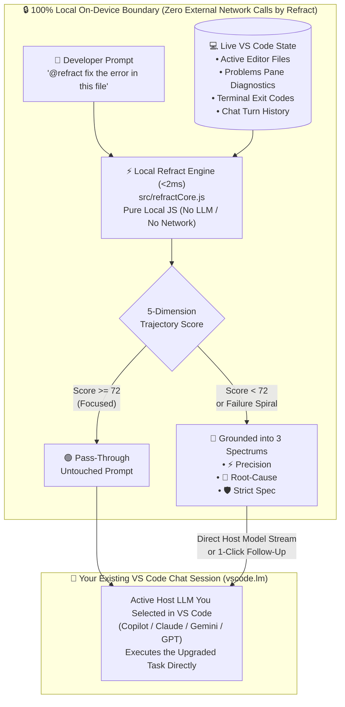

<div align="center">
  
  <h1>💠 Refract</h1>
  <p><strong>AI Context & Prompt Trajectory Engine for VS Code Chat, GitHub Copilot & Google Antigravity</strong></p>
  <p>
    <em>Stop "prompt fluffing." Start Context & Trajectory Engineering.</em>
  </p>
</div>

---

## ⚡ What Is Refract?

Most prompt extensions treat prompt refinement like copywriting—taking a 6-word developer thought (*"fix the auth bug"*) and inflating it into a 200-word generic essay (*"Act as a 10x Senior Engineer..."*) without knowing your conversation history, open editor files, or live compiler errors.

**Refract** is different. Like an optical prism (`💠`) that takes a diffuse beam of light and refracts it into focused spectrums, Refract inspects your **live VS Code conversation history**, **active editor files**, **Problems panel diagnostics**, and **terminal exit codes** in **$<2\text{ms}$** to solve the real reasons coding prompts fail:

- 🔗 **Deictic & Pronoun Context Binding**: Resolves shorthand follow-ups (*"do the same for the other handler"*, *"fix that error in this file"*) to your active editor tabs, recent saves, and open diagnostics.
- 🛟 **Vibe-Coding Failure Spiral Rescue**: Tracks VS Code **Problems** errors (`vscode.languages.getDiagnostics()`) and terminal exit codes (`onDidEndTerminalShellExecution`). When repeated errors or frustration prompts (*"still broken"*, *"same error"*) occur, Refract automatically pivots the agent into **Root-Cause Isolation** instead of blind guessing.
- 🔀 **Pre-Flight Architectural Fork Detection**: Distinguishes between missing file context (auto-bound silently) and genuine architectural forks (e.g., caching strategy, auth flow, database choice) that need a 1-click decision before 10 files are edited.
- 🛡️ **Zero Latency & Zero Extra Token Cost**: Runs a deterministic `<2ms` engine locally inside VS Code's Extension Host—no external API keys required, and strong prompts ($\ge 72/100$) pass through invisibly.

---

## 🧠 How It Works, Data Privacy & LLM Architecture

### In 4 Short Bullets
1. **Intercepts Locally (`<2ms`, 100% On-Device)**: When you message `@refract`, invoke `#refract`, or press `Cmd+Alt+P`, Refract analyzes your prompt locally inside VS Code's built-in Extension Host *before* any LLM is called.
2. **Reads Live IDE Trajectory**: Collects your active editor file paths, live compiler/linter errors from the **Problems** pane, recent terminal failures, and chat turn history (`context.history`).
3. **Scores & Grounds (5-Dimension Rubric)**:
   - **Score $\ge 72$ (Clear)**: Passes through untouched with zero overhead.
   - **Score $< 72$ (Diffuse / Spiral / Fork)**: Binds missing file/diagnostic references and synthesizes 3 execution spectrums (**⚡ Precision**, **🔬 Root-Cause**, **🛡️ Strict Spec**).
4. **Executes with Your Active VS Code Chat Model (`vscode.lm`)**: Forwards the grounded prompt directly to **whichever model you already have selected in VS Code Chat** (`request.model.sendRequest`)—or lets you pick a spectrum with 1 click.

---

### 🔒 Data Privacy & LLM Boundary Diagram



---

### 🤖 At a Glance: Data Privacy & Which LLM Refract Uses

| Question | How Refract Works | Why It Matters |
| :--- | :--- | :--- |
| **Does Refract send my code or prompts outside my machine?** | **No — Never.** Refract contains **zero networking code** (no `fetch`, `http`, or external telemetry). All trajectory analysis, file binding, and diagnostic reading happen 100% in memory on your machine. | Safe for proprietary, enterprise, and NDA codebases. Refract never acts as a third-party proxy. |
| **Which LLM does the `<2ms` analyzer use?** | **None (Deterministic Local Engine).** Refract uses fast local heuristics, AST/identifier pattern matching, and live IDE diagnostic state rather than calling an external LLM. | **$<2\text{ms}$ latency** instead of waiting $2\text{–}4\text{ seconds}$ before every chat message, and **\$0 extra token cost**. |
| **Which LLM executes the refracted prompt?** | **Your Active VS Code Chat Model (`vscode.lm`).** `@refract` uses `request.model.sendRequest` to stream directly from the model you already selected in VS Code's chat picker. | No separate OpenAI/Anthropic/Gemini API keys to configure or pay for. |

---

## 💻 System Requirements & Pre-Flight Checks

Refract is designed so **end-users need zero extra software installed**, while contributors have clear build checks:

| Audience | What You Need Installed | Why |
| :--- | :--- | :--- |
| **VS Code End-Users** *(Installing from Marketplace or `.vsix`)* | **VS Code 1.95+** only (**Zero extra installs!**) | Runs natively inside VS Code's built-in Node.js Extension Host with **0 external `npm` packages** and **no Python required**. |
| **Extension Contributors** *(Packaging `.vsix` from source)* | **Node.js 18+ & npm** *(for `@vscode/vsce` CLI)* **OR** **Python 3.8+** *(for zero-dependency `scripts/build_vsix.py`)* | Lets you package `refract-1.0.0.vsix` either with Microsoft's `@vscode/vsce` CLI or our built-in zero-dependency Python packager. |
| **Google Antigravity Users** *(`main` / `antigravity-extension` branch)* | **Python 3.8+** (standard library only, 0 `pip` packages) | Powers the Antigravity `PreInvocation` lifecycle hook (`scripts/refract_engine.py`). |

### Automated Pre-Flight Check Commands
```bash
# Check environment requirements for VS Code extension development & packaging
./install.sh --check-vscode

# Package refract-1.0.0.vsix with zero Node/npm dependencies (uses Python 3.8+ stdlib)
python3 scripts/build_vsix.py

# Or package via Microsoft's official @vscode/vsce CLI (requires Node.js 18+ & npm)
npx @vscode/vsce package
```

---

## 📋 VS Code Quick Cheatsheet

### 1. Chat Participant Commands (`@refract`)

| Command in VS Code Chat | What It Does | Example |
| :--- | :--- | :--- |
| **`@refract <prompt>`** | Grounds your prompt against active files & diagnostics and executes it with your selected Chat model. | `@refract fix the error in this handler` |
| **`@refract /refract <draft>`** | Scores your prompt across the 5-Dimension Rubric and shows **1-click follow-up buttons** for **⚡ Precision**, **🔬 Root-Cause**, and **🛡️ Strict Spec**. | `@refract /refract make this async and handle timeouts` |
| **`@refract /check <draft>`** | Opens the **Interactive 5-Dimension Trajectory Scorecard** Webview panel beside your editor. | `@refract /check add caching to the user endpoint` |
| **`@refract /mode [mode]`** | View or switch operating mode (`auto-intercept`, `coach`, or `slash-only`). | `@refract /mode coach` |
| **`@refract /doctor`** | Displays live runtime health, bound workspace files, and active Problems count. | `@refract /doctor` |

### 2. Language Model Tool (`#refract` in Any Chat)
Type **`#refract`** inside *any* standard Copilot / Agent Mode chat prompt to let the model invoke the `refract_prompt` tool and ground your request in active workspace diagnostics.

### 3. Keyboard Shortcuts & Command Palette (`Cmd+Shift+P`)

| Shortcut (macOS) | Shortcut (Windows / Linux) | Command Palette Title | What It Does |
| :--- | :--- | :--- | :--- |
| **`Cmd + Alt + P`** | **`Ctrl + Alt + P`** | `💠 Refract: Refract Prompt (3 Spectrums)...` | Pops up an instant input + QuickPick with your 5-Dimension Score and 1-click execution for **⚡ Precision**, **🔬 Root-Cause**, or **🛡️ Strict Spec**. |
| **`Cmd + Alt + Shift + P`** | **`Ctrl + Alt + Shift + P`** | `💠 Refract: Open Interactive Trajectory Scorecard` | Opens the visual 5-Dimension Scorecard Webview beside your active editor. |
| *(Status Bar Click)* | *(Status Bar Click)* | `💠 Refract: Switch Operating Mode...` | Click `💠 Refract: Auto` in the bottom-right status bar to refract a prompt or switch modes. |

---

## ⚙️ Configuration & Custom Team Rules

### VS Code Settings (`settings.json`)
```json
{
  "refract.mode": "auto-intercept",
  "refract.scoreThreshold": 72,
  "refract.rescueFailureSpirals": true,
  "refract.alwaysIncludeRules": [
    "Preserve public TypeScript interfaces",
    "Run unit tests after modifying handlers"
  ]
}
```

### Shared Team Config (`.agents/refract.json` or `.vscode/refract.json`)
Commit `.agents/refract.json` or `.vscode/refract.json` to your repository so both **VS Code** and **Google Antigravity** teammates automatically share the same project rules and score thresholds!

---

## 🌿 Repository Branch Structure

| Branch | Target Platform | Status |
| :--- | :--- | :--- |
| **`main`** | Core trajectory engine & cross-platform overview | ✅ Active |
| **`antigravity-extension`** | **Google Antigravity Native Plugin** (`plugin.json`, `hooks.json`, `skills/`, `rules/`) | ✅ Ready (`v1.0.0`) |
| **`vscode-extension`** | **VS Code Extension** (`package.json`, `src/extension.js`, `@refract`, `#refract`, `Cmd+Alt+P`, `.vsix`) | ✅ Ready (`v1.0.0`) |

---

## 📄 License
MIT
