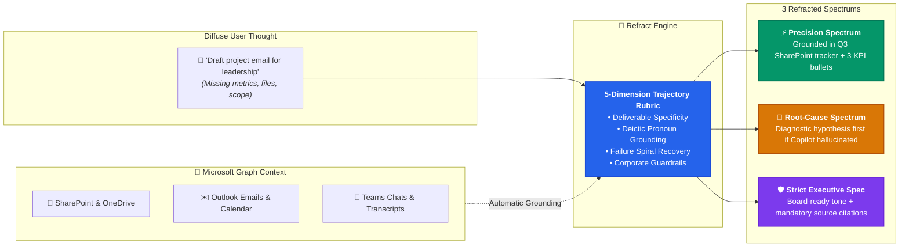
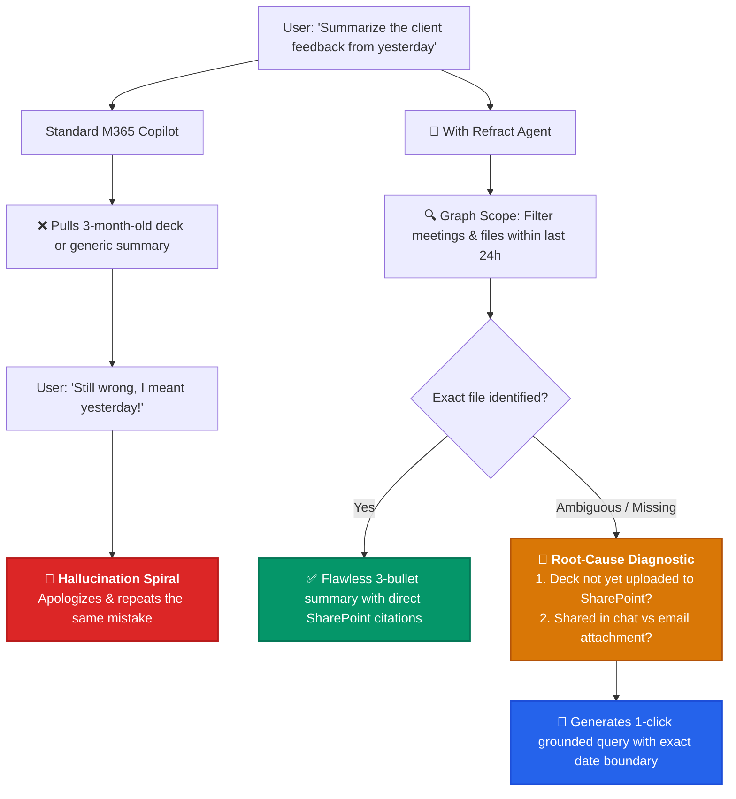
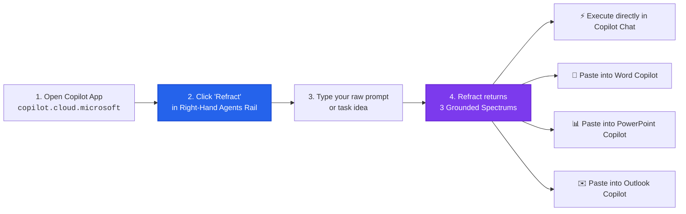

<div align="center">
  
  <h1>💠 Refract for Microsoft 365 Copilot</h1>
  <p><strong>Stop Copilot from guessing blindly. Ground diffuse prompts in your files, emails, and meetings in &lt;2ms.</strong></p>
  
  <p>
    
    
    
    
    
  </p>
</div>

---

## ⚡ How Refract Works: The Enterprise Optical Prism

When you ask Microsoft 365 Copilot to *"draft an update"*, *"summarize yesterday's deck"*, or *"prep for my meeting"*, standard Copilot must guess which files, dates, or attendees you mean. 

**Refract** works like an optical prism (`💠`): it intercepts your diffuse prompt, grounds it in your active Microsoft Graph context (SharePoint, Outlook, Teams), and refracts it into **3 high-impact execution spectrums**:



---

## 🛟 Breaking the Copilot "Failure Spiral"

The single biggest frustration with Microsoft 365 Copilot is the **Hallucination Spiral**:
1. You ask a question.
2. Copilot pulls the wrong SharePoint slide or answers vaguely.
3. You type *"that's not what I asked, try again"*.
4. Copilot apologizes, repeats the exact same flawed query, and wastes 15 minutes of your meeting prep.

**Refract breaks the loop automatically:**



---

## ⚡ Real-World Enterprise Scenarios (Before vs. After)

| When You Type... | Standard Copilot ❌ | With Refract in M365 Copilot 💠 |
| :--- | :--- | :--- |
| **`"Draft a project update email to leadership"`** | Writes generic corporate fluff without mentioning your milestones, metrics, or blockers. | **⚡ Precision Spectrum**: Generates a 3-bullet executive update, prompts you for specific KPIs, and links to your active SharePoint project folder. |
| **`"Summarize that presentation from yesterday"`** | Pulls the wrong deck or hallucinates slides from a 3-month-old file. | **Deictic Grounding**: Queries Microsoft Graph for meetings and files shared in the last 24 hours, confirming the exact deck before summarizing. |
| **`"Still wrong, try again"`** *(Turn 3)* | **Failure Loop**: Repeats the same incorrect text and wastes your meeting prep time. | **🔬 Root-Cause Rescue**: Halts blind retries, identifies why Copilot failed (e.g. missing SharePoint read permissions or ambiguous date scope), and fixes the query. |
| **`"Prepare board meeting notes"`** | Mixes internal draft speculation with official corporate records. | **🛡️ Strict Executive Spec**: Enforces formal tone, executive summary first, bulleted decisions, and mandatory source citations. |

---

## 💠 The 3 Enterprise Spectrums

Whenever Refract enhances a prompt, it presents 3 actionable execution spectrums:

* ⚡ **Precision Spectrum (Context-Grounded — Default)**
  * *Best for*: Everyday emails, status reports, and fast document drafting.
  * *What it does*: Bounds your request to specific SharePoint files and date ranges with clear bulleted takeaways and zero generic fluff.

* 🔬 **Root-Cause / Diagnostic Spectrum (Hypothesis-First)**
  * *Best for*: Breaking out of Copilot hallucination loops or fixing missing data.
  * *What it does*: Halts blind retries. States the top 2 diagnostic hypotheses (missing file access, ambiguous dates, or prompt conflict) and isolates the data source before generating content.

* 🛡️ **Strict Executive Spec (Guardrailed + Cited)**
  * *Best for*: Board memos, client proposals, policy documents, and compliance reviews.
  * *What it does*: Enforces formal executive tone, mandatory source citations, confidentiality flags, and a strict verification checklist.

---

## 📱 How to Use Refract in the Microsoft 365 Copilot App



---

## 🚀 Setup Instructions for the Microsoft 365 Copilot App

You have two simple ways to set up Refract inside the **Microsoft 365 Copilot App** ([copilot.cloud.microsoft](https://copilot.cloud.microsoft)):

### Method 1: 3-Minute Agent Builder Setup (Recommended — No IT Admin Needed)

You can configure Refract directly inside the Microsoft 365 Copilot App web interface:

1. **Open Microsoft 365 Copilot**: Navigate to **[copilot.cloud.microsoft](https://copilot.cloud.microsoft)** in your browser or open the **Microsoft 365 Copilot App**.
2. **Open Agent Builder**: In the right-hand panel under **Agents**, click **+ Create an agent** (or the Agent Builder pencil).
3. **Switch to Configure Tab**: Click the **Configure** tab at the top.
4. **Enter Identity**:
   * **Name**: `Refract`
   * **Description**: `AI Context & Prompt Trajectory Engine. Grounds diffuse prompts in your files, emails, and meetings into 3 focused execution spectrums.`
   * **Icon**: Click the icon circle and upload [`color.png`](appPackage/color.png) (or choose the sparkle/prism icon).
5. **Paste Instructions**: Copy and paste the complete enterprise prompt from [`appPackage/instructions.txt`](appPackage/instructions.txt) into the **Instructions** field.
6. **Enable Knowledge & Work Content**:
   * 🟢 **Cloud files** (SharePoint & OneDrive) → **ON**
   * 🟢 **Outlook** (Emails & Calendar) → **ON**
   * 🟢 **Teams** (Chats & Meeting Transcripts) → **ON**
   * 🟢 **Web search** → **ON**
7. **Add Conversation Starters**:
   * `⚡ Refract Draft Prompt: Refract "Draft a project status update email to leadership based on recent work"`
   * `🔬 Rescue Failure Loop: Copilot gave me a vague, hallucinated response. Diagnose why and fix the query.`
   * `🛡️ Strict Executive Spec: Turn this into a strict, citation-backed executive memo prompt: "Summarize key decisions from yesterday's sync"`
8. **Save & Pin**: Click **Create** (or **Save**) in the top right. Refract is now pinned to your **Agents** rail in Copilot!

---

### Method 2: Sideloading the Pre-Built Package (`refract-m365-copilot.zip`)

If your tenant allows custom app uploading:

1. Download the pre-built [`refract-m365-copilot.zip`](refract-m365-copilot.zip) from this repository.
2. In the Microsoft 365 Copilot App or Microsoft 365 web portal ([m365.cloud.microsoft](https://m365.cloud.microsoft)):
   * Open the **Apps** icon on the left rail → click **Manage your apps** → **Upload an app** → **Upload a customized app**.
   * Select `refract-m365-copilot.zip`.
3. Refract will appear instantly under your **Agents** rail across all Microsoft 365 Copilot surfaces.

> [!NOTE]
> **Enterprise Tenant Rollout**: IT Administrators can deploy Refract company-wide across the entire organization in under 60 seconds by uploading `refract-m365-copilot.zip` in the **[Microsoft 365 Admin Center](https://admin.microsoft.com)** under **Settings** → **Integrated apps** → **Upload custom apps**.

---

## 🛠️ Developer: Zero-Dependency Packaging & Validation

To rebuild or test the Declarative Agent package from source:

```bash
# Package the Microsoft 365 Declarative Agent zip
python3 scripts/build_m365_package.py

# Run the automated validation test suite (14 tests in <10ms)
python3 -m unittest discover -s tests -v
```

---

## 🌿 Repository Branch Structure

| Branch | Target Platform | Status |
| :--- | :--- | :--- |
| **`main`** | Primary release branch & cross-platform documentation | ✅ Active |
| **`m365-copilot`** | **Microsoft 365 Copilot Declarative Agent** (`appPackage/`, `manifest.json`) | 🚀 Ready (v1.0.0) |
| **`vscode-extension`** | **VS Code Marketplace Extension** (`MDMS.refract` v1.0.1) | ✅ [Live on Marketplace](https://marketplace.visualstudio.com/items?itemName=MDMS.refract) |
| **`antigravity-extension`** | **Google Antigravity Native Plugin** (`plugin.json`, `hooks.json`, `skills/`, `rules/`) | ✅ Ready |

---

## 📄 License
MIT
