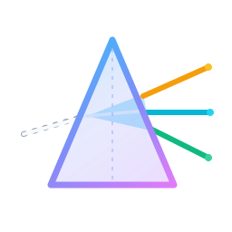
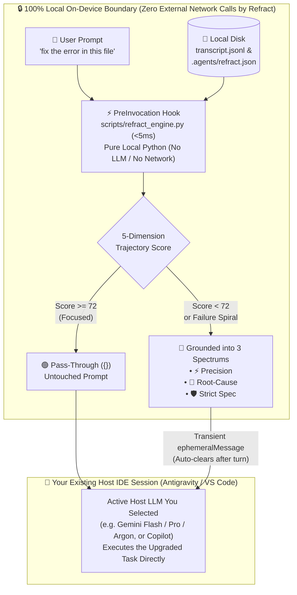

<div align="center">
  
  <h1>💠 Refract</h1>
  <p><strong>AI Context & Prompt Trajectory Engine for Google Antigravity & Modern AI Coding Assistants</strong></p>
  <p>
    <em>Stop "prompt fluffing." Start Context & Trajectory Engineering.</em>
  </p>
</div>

---

## ⚡ What Is Refract?

Most prompt extensions treat prompt refinement like copywriting—taking a 6-word developer thought (*"fix the auth bug"*) and inflating it into a 200-word generic essay (*"Act as a 10x Senior Engineer..."*) without knowing your conversation history or codebase.

**Refract** is different. Like an optical prism (`💠`) that takes a diffuse beam of light and refracts it into focused spectrums, Refract inspects your **live conversation trajectory (`transcript.jsonl`)** and **workspace state** in **$<5\text{ms}$** to solve the real reasons coding prompts fail:

- 🔗 **Deictic & Pronoun Context Binding**: Resolves shorthand follow-ups (*"do the same for the other handler"*, *"fix that error in this file"*) to the exact files, symbols, and tool outputs from earlier turns.
- 🛟 **Vibe-Coding Failure Spiral Rescue**: Detects when recent turns have consecutive tool/test errors or frustration prompts (*"still broken"*, *"same error"*) and automatically pivots the agent into **Root-Cause Isolation** instead of blind guessing.
- 🔀 **Pre-Flight Architectural Fork Detection**: Distinguishes between missing file context (auto-filled silently) and genuine architectural forks (e.g., caching strategy, auth flow, database choice) that need a 1-click decision before 10 files are edited.
- 🛡️ **Zero Latency & Zero Extra Token Cost**: Runs a deterministic `<5ms` pre-invocation engine locally—no secondary API key required, and strong prompts ($\ge 72/100$) pass through invisibly with zero overhead.

---

## 🧠 How It Works, Data Privacy & LLM Architecture

### In 4 Short Bullets
1. **Intercepts Locally (`<5ms`, 100% On-Device)**: When you send a chat message, Antigravity's `PreInvocation` hook runs `scripts/refract_engine.py` locally on your machine *before* any LLM is called.
2. **Reads Local Trajectory**: It scans the tail of your active session (`transcript.jsonl` on local disk) to find recently edited files, test commands run, and any unresolved errors.
3. **Scores & Grounds (5-Dimension Rubric)**:
   - **Score $\ge 72$ (Clear)**: Passes through untouched (`{}`) with zero overhead.
   - **Score $< 72$ (Diffuse / Spiral / Fork)**: Binds missing file/error references and synthesizes 3 execution spectrums (**⚡ Precision**, **🔬 Root-Cause**, **🛡️ Strict Spec**).
4. **Executes with Your Active Host LLM**: Injects a transient `ephemeralMessage` into the current turn so **your already-selected Host IDE model** (e.g., Gemini Flash, Gemini Pro, or Gemini Argon in Antigravity) executes the upgraded task in a single pass.

---

### 🔒 Data Privacy & LLM Boundary Diagram



---

### 🤖 At a Glance: Data Privacy & Which LLM Refract Uses

| Question | How Refract Works | Why It Matters |
| :--- | :--- | :--- |
| **Does Refract send my code or prompts outside my machine?** | **No — Never.** `refract_engine.py` contains **zero networking code** (no `urllib`, `requests`, `http`, or sockets) and collects **zero telemetry**. All transcript parsing and context binding happen 100% on your local disk. | Safe for proprietary, enterprise, and NDA codebases. Refract never acts as a third-party proxy. |
| **Which LLM does the `<5ms` interceptor use?** | **None (Deterministic Local Python).** The `PreInvocation` hook uses fast local regex, heuristics, and `transcript.jsonl` state machine parsing rather than calling an LLM. | **$<5\text{ms}$ latency** instead of waiting $2\text{–}4\text{ seconds}$ before every chat message, and **\$0 extra token cost**. |
| **Which LLM executes the refracted prompt or `/refract` commands?** | **Your Active Host IDE Model.** Refract piggybacks on whichever model you already have selected in Antigravity (e.g., **Gemini 3.8 Flash**, **Gemini Pro**, **Gemini 4 Argon**) or VS Code (`vscode.lm`). | No separate OpenAI/Anthropic/Gemini API keys to configure or pay for, and the model retains full access to your IDE tools. |
| **Does Refract bloat my conversation history?** | **No.** In passive mode, Refract injects an `ephemeralMessage` which Antigravity automatically drops as soon as the turn finishes. | Keeps your context window clean across long coding sessions. |

---

## 💻 System Requirements & Pre-Flight Checks

Refract is engineered with **zero external package bloat** and includes built-in pre-flight requirement verification:

| Target Platform | Branch | Required Runtime / Installs | Third-Party Packages Required |
| :--- | :--- | :--- | :--- |
| **Google Antigravity** *(Phase 1 — Current)* | `main` / `antigravity-extension` | **Python 3.8+** (pre-installed on macOS/Linux) + **Git** | **Zero `pip` packages!** Uses Python standard library only (`sys`, `os`, `json`, `re`, `pathlib`, `html`, `argparse`, `collections`). **No Node.js or npm required.** |
| **VS Code Extension** *(Phase 2 — Roadmap)* | `vscode-extension` | **Node.js 18+** & **npm** *(for building/packaging)* + **Python 3.8+** *(shared core engine)* | `@vscode/prompt-tsx` & `@vscode/vsce` (bundled at build time so end-users installing the `.vsix` need zero `npm install`). |

### Automated Pre-Flight Requirement Check
`./install.sh` automatically verifies your system requirements before installing and alerts you with exact OS-specific install commands if anything is missing. You can also run checks standalone at any time:

```bash
# Check requirements for Google Antigravity (Python 3.8+, stdlib, git)
./install.sh --check

# Check requirements for Phase 2 VS Code Extension development (Node.js 18+, npm, Python 3.8+)
./install.sh --check-vscode

# Run the built-in engine health & bundle integrity doctor
python3 scripts/refract_engine.py --doctor
```

---

## 📋 Quick Cheatsheet

### 1. Slash Commands (Summon Anytime)

| Slash Command | What It Does | Example |
| :--- | :--- | :--- |
| **`/refract [draft]`** | Scores your prompt against conversation history and pops up a **1-click selector** to immediately run **⚡ Precision**, **🔬 Root-Cause**, or **🛡️ Strict Spec**. | `/refract make this handler async and fix the bug` |
| **`/refract-check [draft]`** | Renders an **Interactive Generative UI Scorecard** inline in chat with 5-dimension progress bars, gap diagnostics, and clickable spectrum tabs. | `/refract-check add caching to the user endpoint` |
| **`/refract-mode`** | View or switch Refract's operating mode (`auto-intercept`, `coach`, or `slash-only`). | `/refract-mode` |

---

### 2. The 3 Refracted Spectrums

| Spectrum | Icon | When to Use It | What It Does |
| :--- | :---: | :--- | :--- |
| **Precision** | ⚡ | Everyday coding & follow-ups | Binds your prompt to exact recent file paths, prior turn intent, and active errors while preserving public interfaces. |
| **Root-Cause** | 🔬 | Debugging & "still broken" loops | Forces the agent to state its top 2 root-cause hypotheses and inspect logs/code **before** making another blind edit. |
| **Strict Spec** | 🛡️ | Production changes & refactors | Enforces minimal diff scope, explicit edge-case handling, and verification via your project's test command. |

---

### 3. Operating Modes

| Mode | How It Behaves | Best For |
| :--- | :--- | :--- |
| **`auto-intercept`** *(Default)* | Silently grounds diffuse prompts in-flight, renders a compact `<details><summary>💠 Refracted Prompt...</summary></details>` header at the top of the reply, and executes immediately. | Zero-friction daily coding. |
| **`coach`** | Pauses when a prompt scores below threshold (or hits an architectural fork) and lets you pick which spectrum to run with 1 click. | Deliberate architecture & learning prompt engineering. |
| **`slash-only`** | Disables automatic turn interception; Refract only runs when you explicitly type `/refract` or `/refract-check`. | On-demand diagnostic use only. |

---

## 🚀 Installation & Distribution (Google Antigravity)

### Route 1: Antigravity Marketplace (Preferred)
Once published to the **Google Antigravity Agent Marketplace**:
1. Open **Google Antigravity** → **Skills & Customizations** (`Plugins`) in the left sidebar.
2. Switch to the **Marketplace** tab and search for **`Refract`**.
3. Click **Install** (or ask the agent: *"Install the refract plugin from the marketplace"*).
4. **Restart Antigravity once** so the Language Server activates the `PreInvocation` hook and `/refract`, `/refract-check`, and `/refract-mode` slash commands.

---

### Route 2: Standalone Installation (No Marketplace Required)

#### Option A: Global Machine Install (Works Across All Projects)
```bash
git clone https://github.com/damiththa/Refract.git
cd Refract
./install.sh
```
This validates your Python 3.8+ environment, installs the plugin bundle to `~/.gemini/config/plugins/refract/`, and runs `--doctor`. **Restart Antigravity once** after your first install.

#### Option B: Team / Workspace Install (Committed to Git — Zero Local Setup for Teammates)
Install Refract directly into any project repository so every teammate who opens the repo in Antigravity gets Refract automatically:
```bash
./install.sh --workspace /path/to/your/repo
```
This copies the bundle into `/path/to/your/repo/.agents/plugins/refract/`, which Antigravity auto-discovers with highest workspace priority.

#### Option C: External Path Registration via `.agents/plugins.json`
If you keep a single local clone of `/path/to/Refract` and want to link it without copying files, add `.agents/plugins.json` (or `~/.gemini/config/plugins.json`):
```json
{
  "entries": [
    { "path": "/path/to/parent/folder/containing/refract" }
  ]
}
```

---

## ⚙️ Configuration & Custom Team Rules

### Global Configuration (`~/.gemini/config/plugins/refract/config.json`)
```json
{
  "mode": "auto-intercept",
  "scoreThreshold": 72,
  "rescueFailureSpirals": true,
  "maxTranscriptTurns": 12,
  "alwaysIncludeRules": []
}
```

### Project-Specific Overrides (`<your-repo>/.agents/refract.json`)
Drop a `.agents/refract.json` file into any project repository to enforce project-specific rules in every refracted prompt:
```json
{
  "scoreThreshold": 75,
  "alwaysIncludeRules": [
    "Use strict TypeScript types (no any)",
    "Run npm test before concluding"
  ]
}
```

### CLI Utility Commands
```bash
# Run environment & bundle integrity doctor
python3 ~/.gemini/config/plugins/refract/scripts/refract_engine.py --doctor

# Check current mode and configuration
python3 ~/.gemini/config/plugins/refract/scripts/refract_engine.py --status

# Switch operating mode via terminal
python3 ~/.gemini/config/plugins/refract/scripts/refract_engine.py --set-mode coach
python3 ~/.gemini/config/plugins/refract/scripts/refract_engine.py --set-mode auto-intercept
python3 ~/.gemini/config/plugins/refract/scripts/refract_engine.py --set-mode slash-only

# Adjust the interception score threshold (0-100)
python3 ~/.gemini/config/plugins/refract/scripts/refract_engine.py --set-threshold 75

# Run the automated unit test suite (10 tests in ~6ms)
python3 -m unittest discover -s tests -v
```

---

## 🏛️ Compliance with Official Platform Guidelines

Refract is built strictly to official **Google Antigravity** and **VS Code** extension standards:

- **Antigravity `plugin.json` Schema**: Uses only supported manifest fields (`name`, `displayName`, `version`, `description`, `logo`, `suggestedPrompts`) with a square $256\times256$ high-contrast `assets/logo.svg` containing $>10\%$ safe padding.
- **Root-Level `hooks.json` with Graceful Fallback**: Placed at the plugin root (`./hooks.json`) as required for native Antigravity plugins, using `python3 ./scripts/refract_engine.py 2>/dev/null || echo '{}'` so even if `python3` is missing on a shared machine, the hook safely passes through `{}` and never blocks a chat turn.
- **Consolidated `rules/AGENTS.md`**: Uses a single plain-markdown `rules/AGENTS.md` file without YAML frontmatter for deterministic rule deduplication.
- **VS Code Phase 2 Packaging (`vscode-extension` branch)**: Follows VS Code's `esbuild` single-file bundling guideline so Marketplace `.vsix` users do not need `npm` at runtime, published as `MDMS.refract` on the Visual Studio Marketplace.
- **Microsoft 365 Copilot Declarative Agent (`m365-copilot` branch)**: Strictly adheres to Microsoft Teams App Manifest v1.19 and Declarative Agent Schema v1.6 with zero-dependency standalone packaging (`refract-m365-copilot.zip`).

---

## 🌿 Repository Branch Structure & Multi-Platform Roadmap

| Branch | Target Platform | Status |
| :--- | :--- | :--- |
| **`main`** | Primary release branch & cross-platform documentation | ✅ Active |
| **`antigravity-extension`** | **Google Antigravity Native Plugin** (`plugin.json`, `hooks.json`, `skills/`, `rules/`) | ✅ Ready |
| **`vscode-extension`** | **VS Code Marketplace Extension** (`MDMS.refract` v1.0.1) | ✅ [Live on Marketplace](https://marketplace.visualstudio.com/items?itemName=MDMS.refract) |
| **`m365-copilot`** | **Microsoft 365 Copilot Declarative Agent** (`appPackage/`, `manifest.json`) | ✅ Ready for Sideload / Tenant Deployment |

---

## 📄 License
MIT
