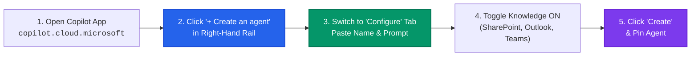

# 📘 Microsoft 365 Copilot Setup & How-To Guide for Refract

This guide walks you through every method of installing, configuring, and using **Refract** in Microsoft 365 Copilot.

---

## 📑 Contents
1. [Overview & Prerequisites](#overview--prerequisites)
2. [Method 1: Web Agent Builder (3 Minutes — Recommended)](#method-1-web-agent-builder-3-minutes--recommended)
3. [Method 2: Sideloading the Pre-Built Package (`.zip`)](#method-2-sideloading-the-pre-built-package-zip)
4. [Method 3: Tenant-Wide Deployment (IT Administrators)](#method-3-tenant-wide-deployment-it-administrators)
5. [Day-to-Day Workflow & Best Practices](#day-to-day-workflow--best-practices)
6. [Security, Governance & Compliance](#security-governance--compliance)
7. [Troubleshooting & FAQ](#troubleshooting--faq)

---

## 1. Overview & Prerequisites

### Prerequisites
- A Microsoft 365 account with an active **Microsoft 365 Copilot license** (Enterprise E3/E5 + Copilot or Business Standard/Premium + Copilot).
- Access to **[copilot.cloud.microsoft](https://copilot.cloud.microsoft)** or the Microsoft 365 Copilot Desktop App.
- Optional: Permissions to upload custom apps in Teams (for Method 2) or Microsoft 365 Admin Center access (for Method 3).

---

## 2. Method 1: Web Agent Builder (3 Minutes — Recommended)

This is the fastest, zero-code way to activate Refract. It does not require tenant admin approval.



### Step-by-Step Instructions:

1. **Navigate to Copilot**: Open your browser and go to **[copilot.cloud.microsoft](https://copilot.cloud.microsoft)**.
2. **Open Agent Builder**: In the right-hand panel labeled **Agents**, click the **+ Create an agent** button (or click the pencil icon next to Agents).
3. **Select Configure Tab**: At the top of the builder view, click the **Configure** tab.
4. **Agent Profile Details**:
   - **Agent Name**: Click the pencil icon next to "New Agent" and enter:
     ```text
     Refract
     ```
   - **Description**: Click "Describe your agent" and enter:
     ```text
     AI Context & Prompt Trajectory Engine. Automatically detects prompt gaps, resolves pronouns, rescues failure loops, and outputs 3 grounded spectrums.
     ```
   - **Icon**: Click the icon circle and upload [`appPackage/color.png`](../appPackage/color.png) (or select the sparkle / prism icon).
5. **Paste Instructions**: Copy the entire text from [`appPackage/instructions.txt`](../appPackage/instructions.txt) and paste it into the **Instructions** box.
6. **Configure Work Content & Knowledge Sources**:
   - 🟢 **Cloud files (SharePoint & OneDrive)**: Toggle **ON**
   - 🟢 **Outlook (Emails & Calendar)**: Toggle **ON**
   - 🟢 **Teams (Chats & Meeting Transcripts)**: Toggle **ON**
   - 🟢 **Web search**: Toggle **ON**
7. **Add Conversation Starters**:
   - Starter 1: `⚡ Refract Draft: "Draft a project status update email to leadership based on recent work"`
   - Starter 2: `🔬 Rescue Failure Loop: Copilot gave me a vague, hallucinated response. Diagnose why and fix the query.`
   - Starter 3: `🛡️ Strict Executive Spec: "Summarize key decisions from yesterday's team sync into a board-ready memo"`
8. **Save & Pin**:
   - Click **Create** (or **Save**) in the top right.
   - In the right-hand **Agents** list, click the **`...`** (three dots) next to **Refract** and click **Pin agent**.

---

## 3. Method 2: Sideloading the Pre-Built Package (`.zip`)

If your Microsoft 365 tenant allows custom app uploading, you can install the version-controlled package directly:

1. **Locate or Build the Package**:
   - The pre-built package is located at [`refract-m365-copilot.zip`](../refract-m365-copilot.zip).
   - Alternatively, build it from the repository root:
     ```bash
     python3 scripts/build_m365_package.py
     ```
2. **Upload into Microsoft 365 / Teams**:
   - Open **Microsoft Teams** (desktop or [teams.microsoft.com](https://teams.microsoft.com)) or the M365 App Portal ([m365.cloud.microsoft](https://m365.cloud.microsoft)).
   - Click **Apps** in the left navigation sidebar.
   - In the bottom-left corner, click **Manage your apps**.
   - Click **Upload an app** → select **Upload a customized app**.
   - Select `refract-m365-copilot.zip`.
3. **Complete Installation**:
   - Click **Add**. Refract is immediately installed and available under your **Agents** rail.

---

## 4. Method 3: Tenant-Wide Deployment (IT Administrators)

For IT teams rolling out Refract to an entire organization:

1. Sign in to the **[Microsoft 365 Admin Center](https://admin.microsoft.com)**.
2. In the left-hand navigation menu, navigate to **Settings** → **Integrated apps**.
3. Click **Upload custom apps**.
4. App Type: Select **Teams app** (Declarative Agents use the Teams v1.19 app manifest standard).
5. Choose **Upload app package (.zip file)** and select `refract-m365-copilot.zip`.
6. Select the rollout audience:
   - **Entire organization** (recommended for enterprise prompt standardization)
   - Or **Specific users/groups** (e.g., Pilot Group, Engineering, Operations).
7. Review permissions and click **Finish deployment**.
8. Within minutes, Refract will automatically appear in the Agents list for all designated users.

---

## 5. Day-to-Day Workflow & Best Practices

### The 2 Ways to Interact with Refract

#### Mode A: The Pinned Agent View (100% Automatic Detection)
- Click **Refract** in the right-hand **Agents rail** inside Microsoft 365 Copilot.
- **Type your thoughts freely**: You do **not** need to type `@Refract` or `/refract` in this view.
- Every message is automatically evaluated against the 5-Dimension Trajectory Rubric.
- If your prompt is missing files, dates, or metrics, Refract automatically identifies them and outputs the 3 Spectrums.

#### Mode B: Group Chats & Meeting Threads (`@Refract`)
- In any Microsoft Teams channel, group chat, or meeting chat, type:
  ```text
  @Refract turn this chat discussion into a 3-bullet decision summary
  ```
- Refract responds inline with grounded summaries and citations.

---

## 6. Security, Governance & Compliance

Refract is designed from the ground up for strict enterprise compliance:

- **100% Tenant Boundary**: Refract runs entirely within your existing Microsoft 365 tenant boundary. No prompts, file contents, or graph data are ever sent to third-party external servers.
- **Inherited ACL & Permissions**: Refract strictly obeys Microsoft 365 permissions. It cannot see or search files, emails, or meetings that the logged-in user does not already have permission to access.
- **Zero Third-Party Model Costs**: Refract leverages your tenant's existing Microsoft 365 Copilot foundation models (no external API keys needed).
- **Microsoft Purview & DLP Compatible**: All audit logging, sensitivity labels, and Data Loss Prevention (DLP) policies enforced in your tenant apply to Refract interactions.

---

## 7. Troubleshooting & FAQ

#### Q: "Upload a customized app" is grayed out in Teams.
**A**: Your IT department has disabled individual app sideloading via Teams App Setup Policies.
- **Solution**: Use **Method 1 (Agent Builder)** inside `copilot.cloud.microsoft`, which only requires a standard user Copilot license and does not require sideloading permissions.

#### Q: Why didn't Refract find a SharePoint file from yesterday?
**A**: Microsoft Graph indexing typically takes between 10 seconds to a few minutes after a file is saved.
- **Solution**: Mention the exact file name or copy the SharePoint link directly into the prompt. Refract's **Deictic Grounding** engine will instantly bind to the file.

#### Q: How do I update Refract when a new version is released?
**A**:
- If using **Method 1 (Agent Builder)**: Open Agent Builder, click **Configure**, paste the updated `instructions.txt`, and click **Save**.
- If using **Method 2 or 3 (App Package)**: Run `python3 scripts/build_m365_package.py`, upload the new `refract-m365-copilot.zip`, and click **Update**.
