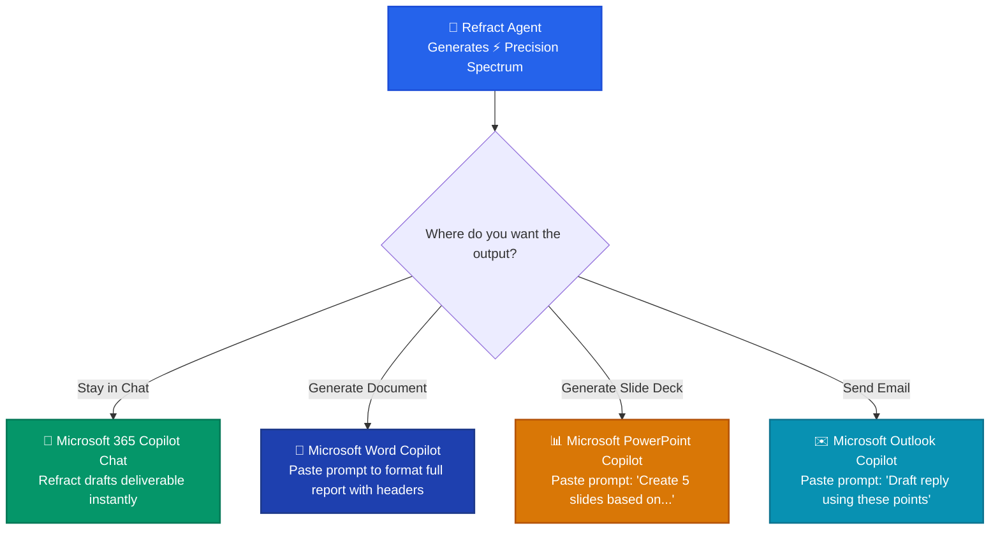

# 💠 Refract for Microsoft 365 Copilot: Real-World Enterprise Examples

This guide provides concrete before-and-after examples of how Refract transforms diffuse business requests into context-grounded, high-precision results across Microsoft 365 Copilot.

---

## 📑 Table of Contents
1. [Example 1: Executive Status Update Email](#example-1-executive-status-update-email)
2. [Example 2: Meeting Deck Summary (Deictic Pronoun Grounding)](#example-2-meeting-deck-summary-deictic-pronoun-grounding)
3. [Example 3: Rescuing a Copilot Hallucination Spiral](#example-3-rescuing-a-copilot-hallucination-spiral)
4. [Example 4: Board Memo with Strict Source Citations](#example-4-board-memo-with-strict-source-citations)
5. [Example 5: Cross-App Usage in Word, PowerPoint & Outlook](#example-5-cross-app-usage-in-word-powerpoint--outlook)

---

## Example 1: Executive Status Update Email

### 👤 What the User Typed (Raw Prompt)
```text
Draft an update email to leadership on our project status.
```

### ❌ What Standard Copilot Does
Generates generic corporate filler:
> *"Subject: Project Update. Dear Leadership, I am pleased to report that the project is progressing well. The team has been working hard to achieve our goals and we are on track for upcoming milestones. Please let me know if you have questions."*
*(No project name, no dates, no KPIs, no blockers mentioned).*

### 💠 How Refract Responds in Microsoft 365 Copilot
```markdown
### 💠 Refract Trajectory Assessment
- **Trajectory Score**: 38/100 (Needs Grounding)
- **Identified Gaps**: Missing project name, undefined deliverable structure, missing KPI metrics, unstated blockers.
- **Bound Graph Context**: Found recent file `Project_Apollo_Q4_Tracker.xlsx` and weekly sync notes in `Teams > Apollo Architecture`.

### ⚡ Precision Spectrum (Context-Grounded — Recommended)
> "Act as the Lead Program Manager for Project Apollo. Draft a 3-bullet status email to VP Leadership based on 'Project_Apollo_Q4_Tracker.xlsx' for the week of Oct 27–Nov 2. 
> Structure:
> 1. Key Accomplishments: Highlight the 99.95% API uptime and completion of Milestone B.
> 2. Critical Blockers: Call out the pending vendor security review by Nov 7.
> 3. Next 7 Days: Outline the staging deployment schedule.
> Tone: Executive Bottom-Line Up Front (BLUF), max 180 words, no filler adjectives."

### 🔬 Root-Cause / Diagnostic Spectrum
> "Query Project_Apollo_Q4_Tracker.xlsx. If Milestone B completion date is missing or conflicting across worksheets, isolate the most recent entry from the 'Weekly_Log' tab before drafting the email."

### 🛡️ Strict Executive Spec (Guardrailed + Cited)
> "Draft a formal status memorandum for Executive Leadership. Mark as 'Internal Confidential - Apollo Core'. Every metric must cite the exact cell reference from the Q4 Tracker. Include an explicit decision request for the vendor review approval."

### 📝 Completed Deliverable (Precision Grounded)
**Subject**: [Update] Project Apollo — Weekly Executive Brief (Oct 27–Nov 2)

**Leadership Team**,

Here is the weekly executive summary for Project Apollo:

* **Key Accomplishments**: Completed Milestone B (Core Service Migration) 2 days ahead of schedule. Core API uptime held at **99.95%** across 1.4M transactions.
* **Active Blocker**: Third-party vendor SOC2 security sign-off is pending approval. Escalated to Security Compliance for sign-off by Thursday, Nov 7 to prevent Staging slip.
* **Next 7 Days**: Initiating Staging deployment on Tuesday; conducting end-to-end load testing on Thursday.

*Full details logged in [Project Apollo Q4 Tracker](https://sharepoint.com/teams/apollo/Project_Apollo_Q4_Tracker.xlsx).*
```

---

## Example 2: Meeting Deck Summary (Deictic Pronoun Grounding)

### 👤 What the User Typed (Raw Prompt)
```text
Summarize that presentation from yesterday's meeting and list action items.
```

### ❌ What Standard Copilot Does
Copilot gets confused by *"that presentation"* and *"yesterday's meeting"*. It either asks three clarifying questions or grabs a 4-month-old deck with a similar title.

### 💠 How Refract Responds in Microsoft 365 Copilot
```markdown
### 💠 Refract Trajectory Assessment
- **Trajectory Score**: 45/100 (Deictic Grounding Required)
- **Identified Gaps**: Ambiguous reference "that presentation"; ambiguous calendar event "yesterday's meeting".
- **Bound Graph Context**: 
  - Meeting: `Client Onboarding Sync with Meridian Health` (Yesterday, 3:00 PM EST).
  - Deck shared in meeting chat: `Meridian_Onboarding_Architecture_v3.pptx` (modified by Alex Chen).

### ⚡ Precision Spectrum (Context-Grounded — Recommended)
> "Review 'Meridian_Onboarding_Architecture_v3.pptx' shared during yesterday's 3:00 PM 'Client Onboarding Sync'.
> Provide:
> 1. Executive Summary: 3 sentences summarizing the hybrid cloud integration model.
> 2. Architectural Decisions: 4 bullet points outlining API gateway and auth requirements.
> 3. Action Items Table: Columns for [Task, Owner, Due Date], extracting commitments made in the meeting transcript."

### 🔬 Root-Cause / Diagnostic Spectrum
> "Check if 'Meridian_Onboarding_Architecture_v3.pptx' in Teams chat contains newer slides than the SharePoint repository version. Highlight any unassigned action items mentioned in the meeting transcript."

### 🛡️ Strict Executive Spec (Guardrailed + Cited)
> "Generate a formal Client Integration Summary. Every architecture requirement must reference the specific PPT slide number (e.g., Slide 7: Auth Flow). Flag any action item with an unconfirmed owner as [PENDING OWNER]."
```

---

## Example 3: Rescuing a Copilot Hallucination Spiral

### 👤 The Situation
You asked Copilot for the Q3 regional revenue numbers. Copilot gave you outdated 2024 numbers from an old archive folder.
You reply in frustration:
```text
That's wrong, those aren't the right numbers. Try again and look at the real sheet.
```

### ❌ What Standard Copilot Does
> *"I apologize for the mistake! Let me try again..."*
*(Proceeds to search the exact same query, quotes slightly different outdated numbers, and locks you into a frustrating failure loop).*

### 💠 How Refract Responds in Microsoft 365 Copilot
```markdown
### 💠 Refract Trajectory Assessment
- **Trajectory Score**: 25/100 (🚨 Failure Spiral Detected)
- **Root Cause Hypothesis**:
  1. *Version Conflict*: Multiple files named `Regional_Revenue` exist in SharePoint (archive folder vs active 2026 finance site).
  2. *Permissions Boundary*: Active file `FY26_Q3_Regional_Revenue_Official.xlsx` was modified 3 days ago by Finance Director Sarah Jenkins.

### 🔬 Root-Cause / Diagnostic Spectrum (Recommended)
> "Stop standard search. Query SharePoint specifically within the 'Finance > Regional Reports > FY26' document library. Filter exclusively for files modified after October 1, 2026. Ignore any files in the 'Archive' or 'Drafts' folders. Confirm the file title is 'FY26_Q3_Regional_Revenue_Official.xlsx' before pulling figures."

### ⚡ Precision Spectrum
> "From 'FY26_Q3_Regional_Revenue_Official.xlsx' (Sheet: 'Q3_Final_Summary'), extract:
> 1. Total Q3 Regional Revenue across North America, EMEA, and APAC.
> 2. Percentage growth vs Q2 for each region.
> Format as a clean markdown table with exact dollar figures ($M) and percentage delta."

### 🛡️ Strict Executive Spec
> "Extract Q3 revenue metrics with mandatory cell references (e.g., NA Revenue: $42.3M [Sheet: Q3_Final_Summary, Cell D14]). Append a verification note verifying that numbers match the signed CFO audit memo."
```

---

## Example 4: Board Memo with Strict Source Citations

### 👤 What the User Typed (Raw Prompt)
```text
Write a board memo about our AI infrastructure spending and budget runway.
```

### 💠 How Refract Responds in Microsoft 365 Copilot
```markdown
### 💠 Refract Trajectory Assessment
- **Trajectory Score**: 52/100 (High-Stakes Deliverable / Spec Required)
- **Identified Gaps**: Unspecified budget period, undefined runway horizon, missing sensitivity classification.
- **Bound Graph Context**: `Infrastructure_CapEx_2026.xlsx`, `Board_Runway_Model_v4.xlsx`.

### 🛡️ Strict Executive Spec (Recommended for Board Deliverables)
> "Act as Chief Technology Officer drafting a formal Board Memorandum.
> Header:
> - TO: Board of Directors
> - FROM: CTO & VP Engineering
> - DATE: November 2026
> - CLASSIFICATION: Highly Confidential — Board Level
> Structure:
> 1. Executive Summary (BLUF): State total 2026 AI infrastructure spend ($X.XM) and remaining runway (X months) in the first paragraph.
> 2. Cost Drivers Breakdown: Table with columns [Cluster Compute, Storage, Model Licensing, Cloud Egress, Total] citing exact worksheets from 'Infrastructure_CapEx_2026.xlsx'.
> 3. 12-Month Runway Scenarios: Base Case (18 months) vs Accelerated Hiring Case (14 months) sourced from 'Board_Runway_Model_v4.xlsx'.
> 4. Verification Table: Every dollar amount must cite the source file and timestamp. Zero speculation."
```

---

## Example 5: Cross-App Usage in Word, PowerPoint & Outlook

When Refract generates a **⚡ Precision Spectrum**, you can execute it right inside Copilot Chat, or copy-paste it directly into in-app Copilot:


